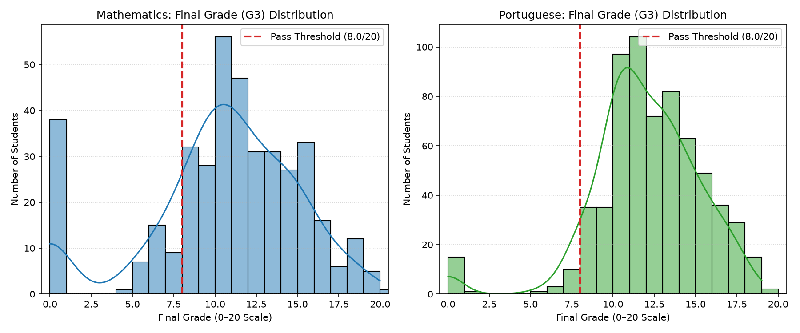
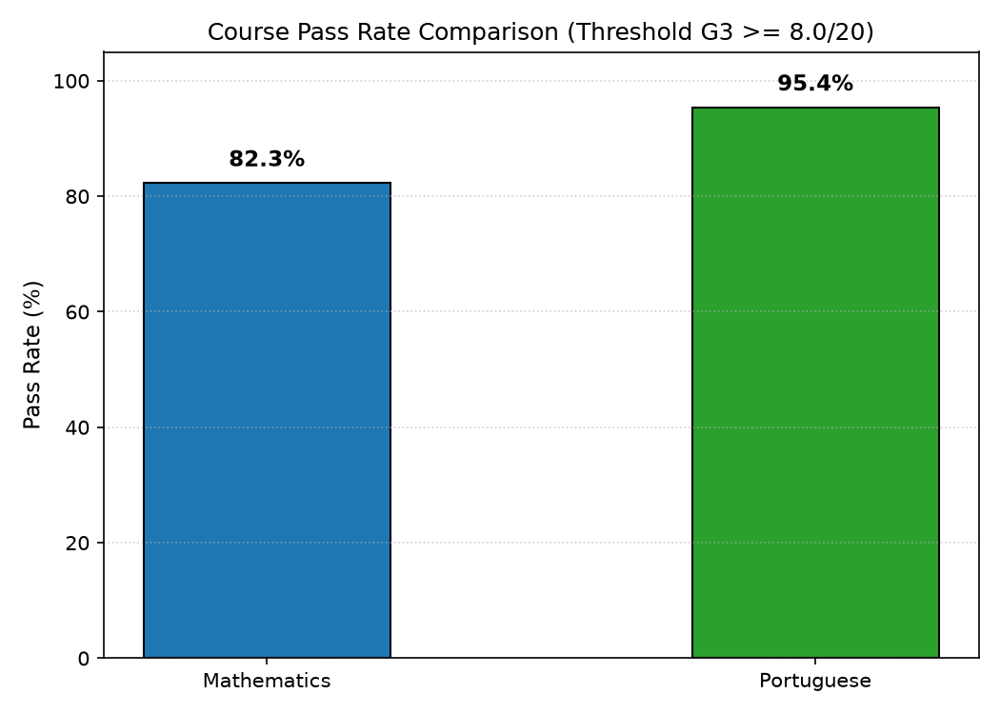
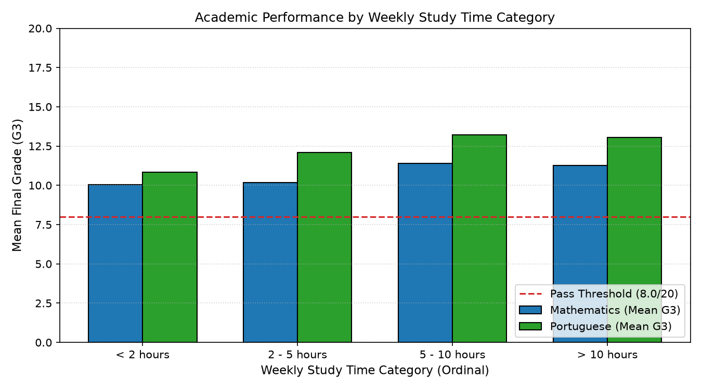
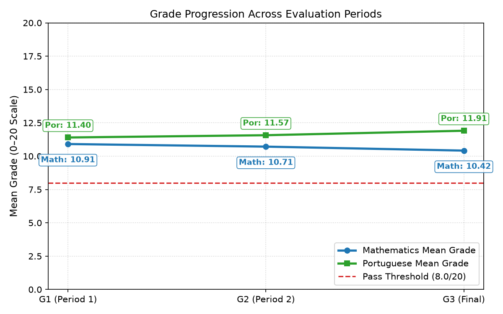

# Student Performance Analysis Report

- **Generated:** 2026-10-25 07:48:05
- **Tool:** Student Performance Analyzer (Python CLI, modular architecture)
- **Data Source:** UCI Machine Learning Repository (*Student Performance*)

---

## 1. Dataset Provenance, Attribution, and Project Disclosure

- **Dataset Title:** Student Performance
- **Publisher:** UCI Machine Learning Repository
- **Official URL:** [https://archive.ics.uci.edu/dataset/320/student+performance](https://archive.ics.uci.edu/dataset/320/student+performance)
- **DOI:** [10.24432/C5TG7T](https://doi.org/10.24432/C5TG7T)
- **License:** [Creative Commons Attribution 4.0 International (CC BY 4.0)](https://creativecommons.org/licenses/by/4.0/)
- **UCI Dataset Citation:** Cortez, P. (2008). Student Performance [Dataset]. UCI Machine Learning Repository. https://doi.org/10.24432/C5TG7T
- **Original Publication Citation:** Cortez, P., & Silva, A. (2008). Using data mining to predict secondary school student performance. Proceedings of the 5th Annual Future Business Technology Conference (FUBUTEC 2008), pp. 5-12.

### Project Modifications and Governance Disclosure
In compliance with CC BY 4.0 attribution requirements, the following project changes are disclosed:
1. **Unmodified Source Files:** Raw CSV files (`student-mat.csv` and `student-por.csv`) are ingested without modifying underlying source records.
2. **Surrogate Keys:** A sequential per-file surrogate key (e.g. `MAT_####`, `POR_####`) is assigned strictly for internal audit traceability. Neither file contains an official student ID.
3. **Derived Outcome Flag:** A boolean `passed` flag was generated applying the project's illustrative benchmark (G3 >= 8.0 / 20).
4. **Aggregate Output Only:** To safeguard student privacy and ensure ethical compliance, this report contains zero row-level student records or personal identifiable information.

---

## 2. Analytical Principles and Guardrails

### 2.1 Course Independence and Demographic Non-Linking
The Mathematics (`student-mat.csv`) and Portuguese (`student-por.csv`) datasets are analyzed as parallel, independent cohorts. Although UCI documentation notes that 382 students overlap across courses, demographic matching is inherently imprecise and lacks an official student ID. **This project strictly forbids record-level merging or matching across files.**

### 2.2 Primary Outcome and Illustrative Pass Threshold
- **Primary Metric:** `G3` (final period evaluation, 0–20 integer scale) serves as the sole outcome variable for the pass/fail evaluation.
- **No Averaging:** `G1` and `G2` evaluate intermediate academic periods and are never averaged with `G3` to determine pass status.
- **Illustrative Threshold (8.0 / 20):** A student achieves an illustrative pass if G3 >= 8.0 out of 20. This corresponds to 40.0% of the 0–20 grading scale and is an illustrative project threshold for analytical demonstration. **This benchmark represents this project's illustrative definition and does not represent an official school policy.**

### 2.3 Ordinal Weekly Study Time
The `studytime` attribute represents four binned interval categories (1: <2h, 2: 2–5h, 3: 5–10h, 4: >10h). It is treated strictly as an ordinal factor and never as continuous physical hours.

### 2.4 Duplicate Detection Without Silent Deletion
All 33 raw features were audited for exact duplicate entries. Detected duplicates are logged and reported; rows are never silently removed or altered.

---

## 3. Data Ingestion & Quality Audit

| Cohort / File | SHA-256 Checksum | Ingested Records | Exact Duplicates | Missing Values | Invalid Grades (G1/G2/G3) | Invalid Studytime | Gradable Records |
| :--- | :--- | :--- | :--- | :--- | :--- | :--- | :--- |
| **Mathematics** (`student-mat.csv`) | `e47f9ee225e1ee6e69b7564e6dac7123e80b8486677fe111f351964cef5dec80` | 395 | 0 | 0 | 0 / 0 / 0 | 0 | 395 |
| **Portuguese** (`student-por.csv`) | `a7594a11d7771c0efe1a740824e0e833da9c4cad07c39a9766a874575563fb3f` | 649 | 0 | 0 | 0 / 0 / 0 | 0 | 649 |

- **Mathematics Audit Note:** Mathematics: 395 rows audited. 0 exact duplicates detected. All rows preserved without silent deletion. (Validation: Out-of-range G1=0, G2=0, G3=0; Invalid studytime=0)
- **Portuguese Audit Note:** Portuguese: 649 rows audited. 0 exact duplicates detected. All rows preserved without silent deletion. (Validation: Out-of-range G1=0, G2=0, G3=0; Invalid studytime=0)

---

## 4. Mathematics Course Performance (`student-mat.csv`)

- **Total Cohort Size:** 395 students
- **Illustrative Pass Rate (G3 >= 8.0 / 20):** **82.3%** (325 passed, 70 failed)

### Evaluation Period Grade Summary

| Period | Metric | Mean | Std Dev | Median | Min | Max | Q25 | Q75 |
| :--- | :--- | :--- | :--- | :--- | :--- | :--- | :--- | :--- |
| **G1** | Period Grade | 10.91 | 3.32 | 11.0 | 3 | 19 | 8.0 | 13.0 |
| **G2** | Period Grade | 10.71 | 3.76 | 11.0 | 0 | 19 | 9.0 | 13.0 |
| **G3 (Final)** | Period Grade | 10.42 | 4.58 | 11.0 | 0 | 20 | 8.0 | 14.0 |

### Study Time Ordinal Breakdown (Mathematics)

| Category | Interval Description | Students | Cohort % | Mean G3 | Median G3 | Pass Rate |
| :--- | :--- | :--- | :--- | :--- | :--- | :--- |
| **1** | < 2 hours | 105 | 26.6% | 10.05 | 10.0 | 79.0% |
| **2** | 2 - 5 hours | 198 | 50.1% | 10.17 | 11.0 | 81.3% |
| **3** | 5 - 10 hours | 65 | 16.5% | 11.40 | 12.0 | 89.2% |
| **4** | > 10 hours | 27 | 6.8% | 11.26 | 12.0 | 85.2% |

---

## 5. Portuguese Course Performance (`student-por.csv`)

- **Total Cohort Size:** 649 students
- **Illustrative Pass Rate (G3 >= 8.0 / 20):** **95.4%** (619 passed, 30 failed)

### Evaluation Period Grade Summary

| Period | Metric | Mean | Std Dev | Median | Min | Max | Q25 | Q75 |
| :--- | :--- | :--- | :--- | :--- | :--- | :--- | :--- | :--- |
| **G1** | Period Grade | 11.40 | 2.75 | 11.0 | 0 | 19 | 10.0 | 13.0 |
| **G2** | Period Grade | 11.57 | 2.91 | 11.0 | 0 | 19 | 10.0 | 13.0 |
| **G3 (Final)** | Period Grade | 11.91 | 3.23 | 12.0 | 0 | 19 | 10.0 | 14.0 |

### Study Time Ordinal Breakdown (Portuguese)

| Category | Interval Description | Students | Cohort % | Mean G3 | Median G3 | Pass Rate |
| :--- | :--- | :--- | :--- | :--- | :--- | :--- |
| **1** | < 2 hours | 212 | 32.7% | 10.84 | 11.0 | 91.5% |
| **2** | 2 - 5 hours | 305 | 47.0% | 12.09 | 12.0 | 96.4% |
| **3** | 5 - 10 hours | 97 | 14.9% | 13.23 | 13.0 | 100.0% |
| **4** | > 10 hours | 35 | 5.4% | 13.06 | 13.0 | 97.1% |

---

## 6. Aggregate Cross-Course Comparison

| Dimension | Mathematics Cohort | Portuguese Cohort | Delta / Note |
| :--- | :--- | :--- | :--- |
| **Sample Size (N)** | 395 | 649 | Portuguese has 254 more instances |
| **Pass Rate (G3 >= 8.0/20)** | 82.3% | 95.4% | Portuguese pass rate is +13.1 percentage points higher |
| **Final Grade Mean (G3)** | 10.42 | 11.91 | Portuguese mean is +1.49 points higher |
| **Final Grade Median (G3)** | 11.0 | 12.0 | Portuguese median is +1.0 points higher |

### Key Comparative Observations
- Mathematics cohort size: N=395; Portuguese cohort size: N=649.
- Mathematics pass rate (G3 >= 8.0/20): 82.3% (325/395).
- Portuguese pass rate (G3 >= 8.0/20): 95.4% (619/649).
- Mathematics mean G3: 10.42 (median 11.0); Portuguese mean G3: 11.91 (median 12.0).
- Cohort comparison is strictly aggregate. Records were not merged or linked across files.

---

## 7. Analytical Visualizations

### Grade Distributions

### Pass Rates Comparison

### Studytime Performance

### Period Grade Progression

---

## 8. Limitations and Non-Causal Disclaimer

1. **Exploratory Scope:** This analysis provides descriptive cohort statistics and exploratory comparisons. It makes no predictive claims, causal inferences, or automated interventions.
2. **Independent Sampling:** As established in project methodology, Mathematics and Portuguese cohorts are analyzed as separate entities without student-level linkage.
3. **Illustrative Benchmark:** The configured threshold is purely an illustrative benchmark for analytical demonstration and does not reflect an official school policy.
